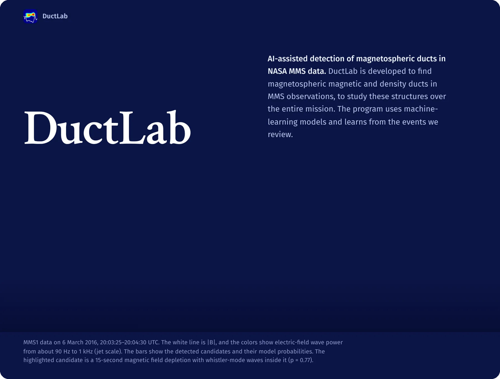
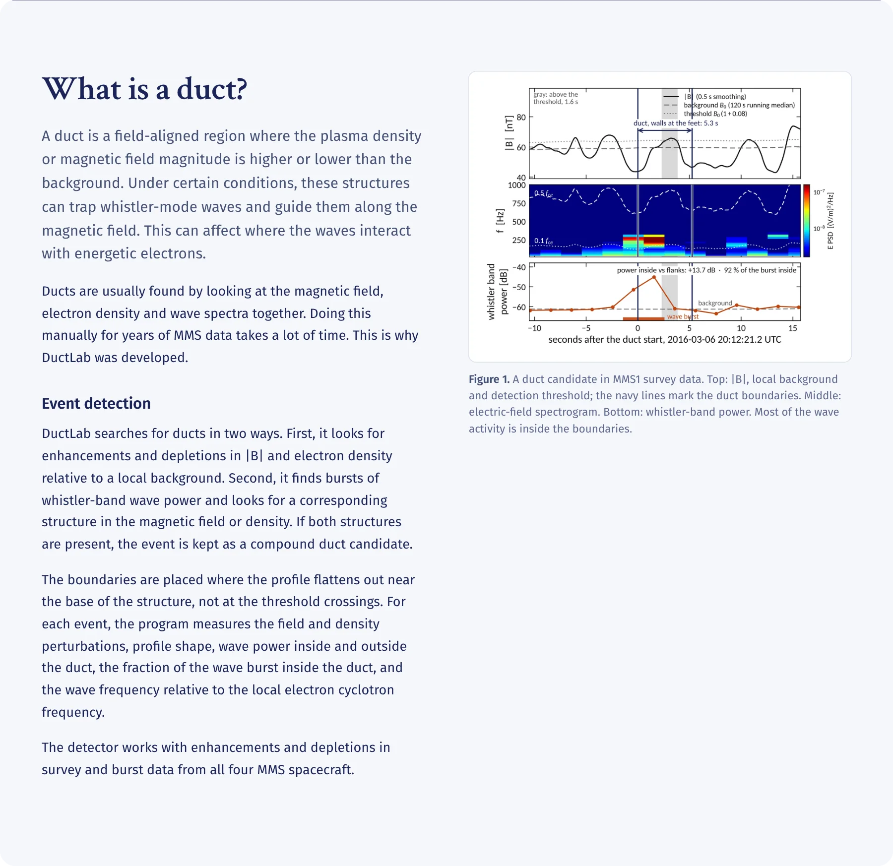
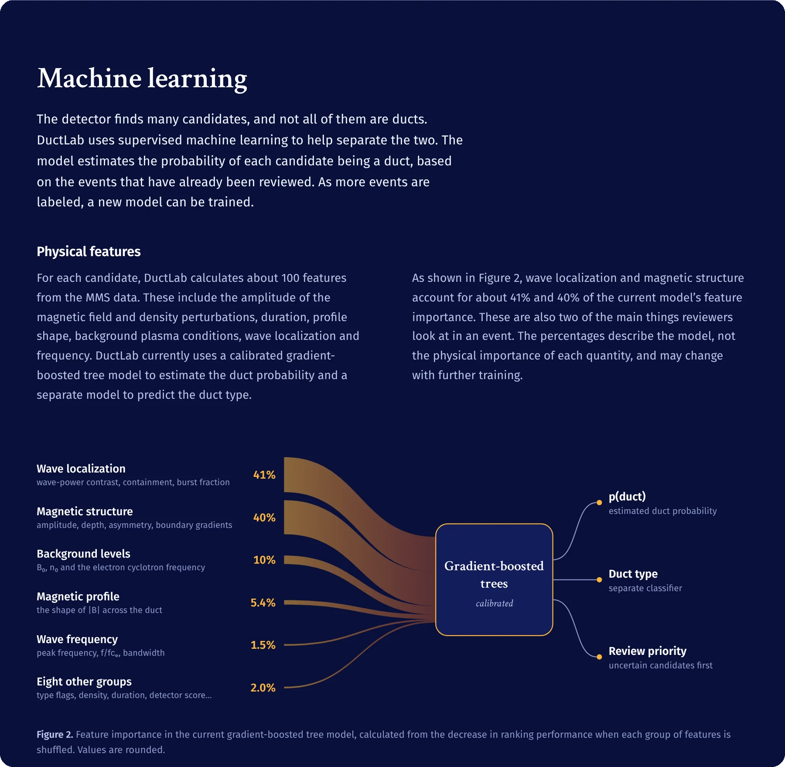
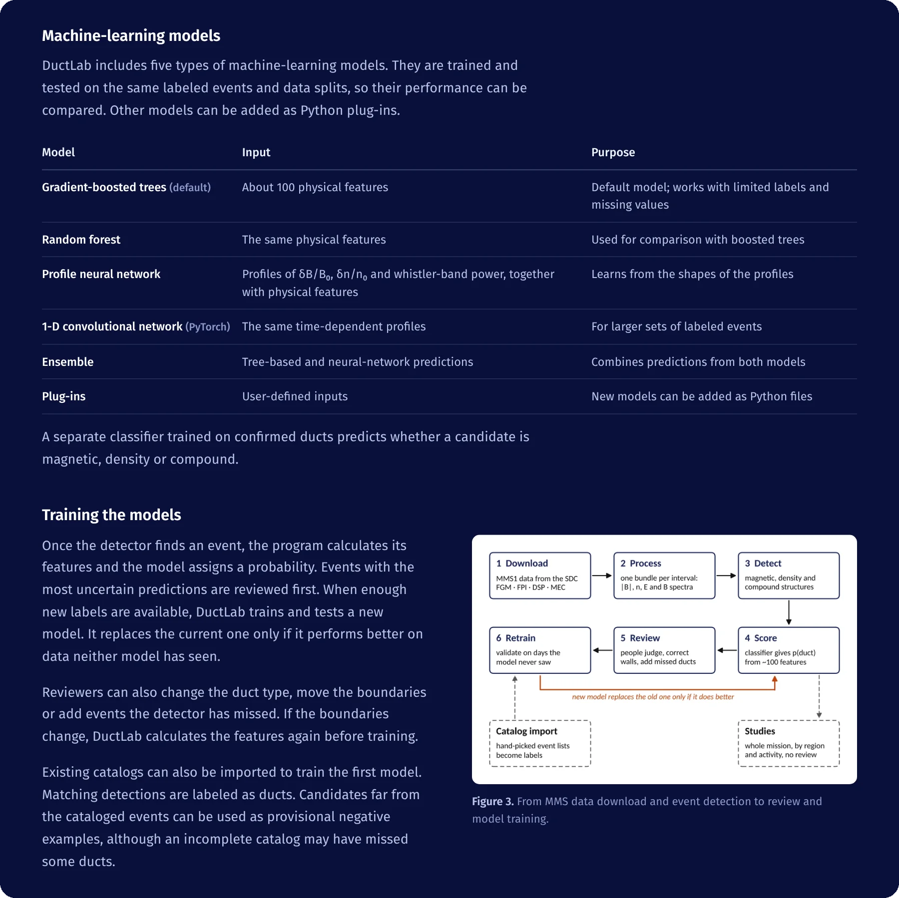
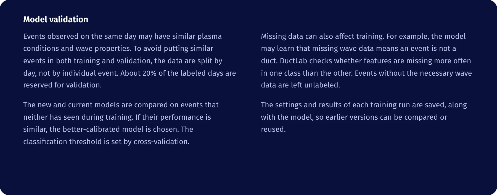
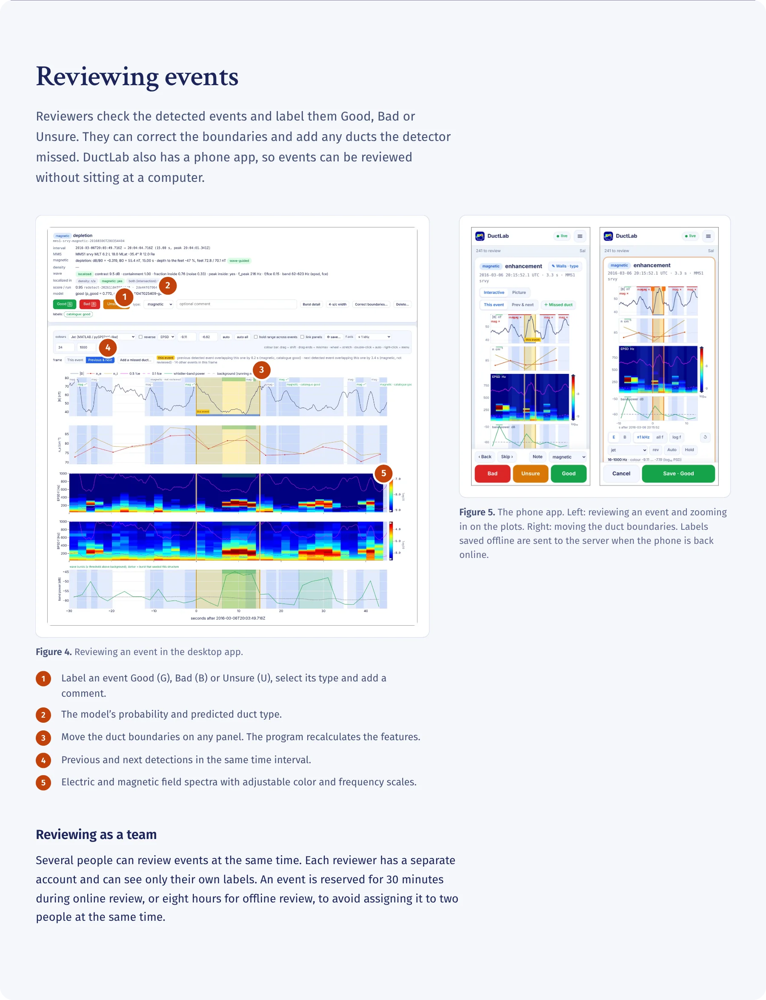
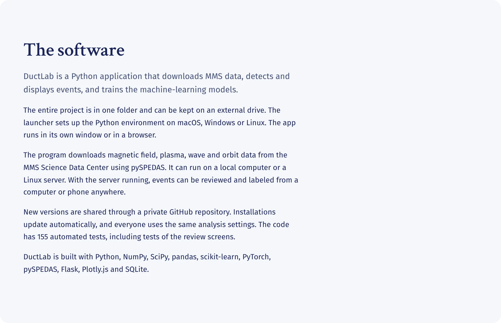
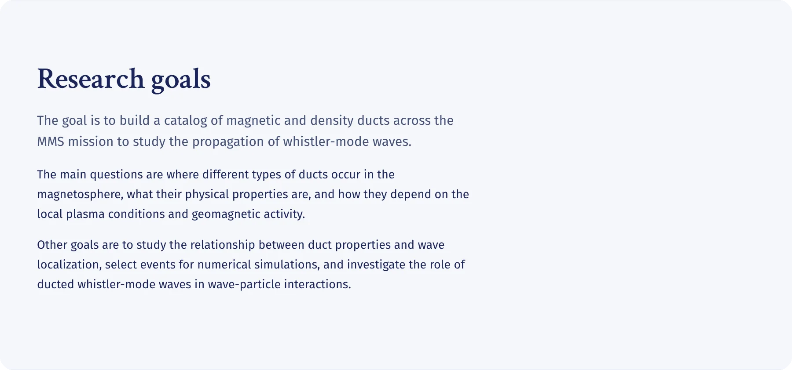
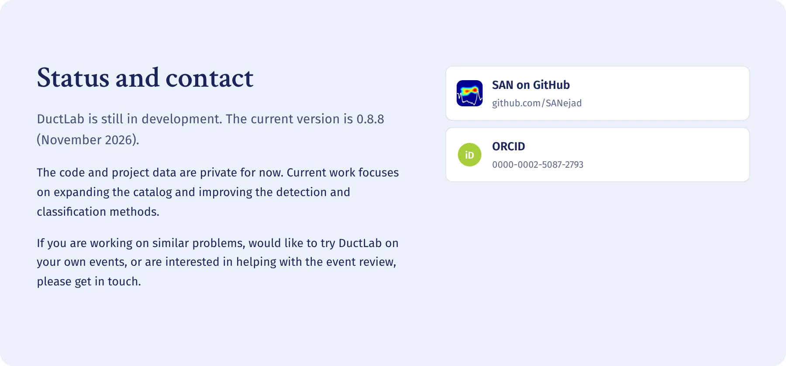

  <a href="https://sanejad.github.io/DuctLab-Overview/">
    <picture>
      <source media="(prefers-reduced-motion: reduce)" srcset="https://raw.githubusercontent.com/SANejad/DuctLab-Overview/main/assets/readme/01-hero-still.webp">
      
    </picture>
  </a>

  <a href="https://sanejad.github.io/DuctLab-Overview/#ducts">
    <picture>
      <source media="(prefers-color-scheme: dark)" srcset="https://raw.githubusercontent.com/SANejad/DuctLab-Overview/main/assets/readme/02-ducts-dark.webp">
      
    </picture>
  </a>

  <a href="https://sanejad.github.io/DuctLab-Overview/#review">
    <picture>
      <source media="(prefers-color-scheme: dark)" srcset="https://raw.githubusercontent.com/SANejad/DuctLab-Overview/main/assets/readme/04-review-dark.webp">
      
    </picture>
  </a>

  <a href="https://sanejad.github.io/DuctLab-Overview/#software">
    <picture>
      <source media="(prefers-color-scheme: dark)" srcset="https://raw.githubusercontent.com/SANejad/DuctLab-Overview/main/assets/readme/05-software-dark.webp">
      
    </picture>
  </a>

  <a href="https://sanejad.github.io/DuctLab-Overview/#research">
    <picture>
      <source media="(prefers-color-scheme: dark)" srcset="https://raw.githubusercontent.com/SANejad/DuctLab-Overview/main/assets/readme/06-research-dark.webp">
      
    </picture>
  </a>

  <a href="https://sanejad.github.io/DuctLab-Overview/#status">
    <picture>
      <source media="(prefers-color-scheme: dark)" srcset="https://raw.githubusercontent.com/SANejad/DuctLab-Overview/main/assets/readme/07-status-dark.webp">
      
    </picture>
  </a>

  <a href="https://sanejad.github.io/DuctLab-Overview/"><b>Project Website</b></a>
  &nbsp;&nbsp;|&nbsp;&nbsp;
  <a href="https://github.com/SANejad">GitHub</a>
  &nbsp;&nbsp;|&nbsp;&nbsp;
  <a href="https://orcid.org/0000-0002-5087-2793">ORCID</a>

> [!NOTE]
> DuctLab is currently under development. This repository provides an overview of the project, its scientific objectives, and the software methodology. The source code and research data are not publicly available at this stage.

<b>Project description and methodology</b>

## DuctLab

**AI-assisted detection and classification of magnetospheric ducts using NASA MMS observations.**

DuctLab was started as part of research on the 
propagation and ducting of whistler-mode waves in the Earth's 
magnetosphere. The original motivation was to reduce the amount 
of time spent manually searching spacecraft observations for 
magnetic and density structures capable of guiding these waves.

DuctLab combines physics-based event detection with supervised 
machine learning. The long-term objective is to develop a 
systematic catalog of magnetospheric ducts throughout the 
Magnetospheric Multiscale (MMS) mission and use it to investigate 
the occurrence, physical properties, and distribution of these 
structures.

The software handles data acquisition, event detection, feature 
extraction, classification, manual inspection, and model training 
within the same application.

### What is a magnetospheric duct?

A magnetospheric duct is a localized, field-aligned enhancement 
or depletion in the plasma density or magnetic field magnitude. 
Under appropriate plasma and wave conditions, these structures 
can trap whistler-mode waves and guide their propagation along 
the background magnetic field.

The presence of a duct can modify the propagation direction, 
spatial distribution, and interaction of whistler-mode waves 
with energetic electrons.

Identifying these structures in spacecraft observations usually 
requires simultaneous examination of magnetic field measurements, 
electron density, and electric and magnetic field wave spectra. 
This is manageable for individual case studies but becomes 
increasingly difficult when working with several years of 
spacecraft data.

DuctLab was developed to extend this type of investigation from 
individual events to mission-scale statistical studies.

#### Event detection

The detection algorithm examines variations in the magnetic 
field magnitude and electron density relative to their respective 
local backgrounds.

Two complementary detection procedures are used. The first 
identifies magnetic and density enhancements or depletions that 
exceed specified thresholds. The second identifies intervals 
of enhanced whistler-mode wave activity and examines the 
surrounding plasma and magnetic field measurements for possible 
duct structures.

Events associated with both magnetic field and density variations 
are retained as compound duct candidates.

The boundaries of each candidate are determined from the local 
field or density profiles, extending toward the base of the 
structure rather than simply using the threshold crossings. 
This allows the subsequent analysis to include the gradients 
and the full spatial extent of the observed structure.

Several quantities are then calculated to characterize the event, 
including the relative field and density perturbations, event 
duration, profile morphology, wave power inside and outside 
the duct boundaries, and the wave frequency normalized to the 
local electron cyclotron frequency.

These quantities form the physical basis of the machine-learning 
analysis.

### Machine learning

Machine learning is used to assist the identification and 
classification of duct candidates rather than replace the 
physical detection criteria.

The initial detection procedure intentionally retains a relatively 
large number of candidates. Many of these require further 
inspection to determine whether the observed plasma structure 
and wave activity are consistent with whistler-mode wave ducting.

A supervised classifier assigns a probability to each candidate 
based on previously reviewed events. As additional events are 
examined and labeled, the training dataset grows and the models 
can be retrained.

#### Physical features

Each candidate is represented by approximately 100 features 
derived from the spacecraft measurements.

These include the magnitude of the magnetic and density 
perturbations, event duration, profile geometry, local background 
plasma conditions, wave localization, and characteristic wave 
frequencies.

The current classifier is a calibrated gradient-boosted tree 
model that estimates the probability that a detected candidate 
corresponds to a duct. A separate classifier determines the 
most likely duct type: magnetic, density, or compound.

The feature importance of the current model is distributed 
approximately as follows:

| Feature group | Relative importance |
|---|---:|
| Wave localization | 41.0% |
| Magnetic structure | 40.0% |
| Background plasma conditions | 10.0% |
| Magnetic field profile | 5.4% |
| Wave frequency | 1.5% |
| Other feature groups | 2.0% |

The relatively high importance of wave localization and magnetic 
structure is consistent with the quantities examined when 
identifying these events manually.

These values represent the feature importance of the current 
trained model and may change as the labeled dataset expands.

#### Available machine-learning models

DuctLab includes several machine-learning architectures, ranging 
from conventional tree-based classifiers to neural networks that 
operate directly on the observed profiles.

The models use a common training and evaluation framework, 
allowing their performance to be compared using the same 
underlying labeled events and data partitions.

| Model | Input | Purpose |
|---|---|---|
| Gradient-boosted trees (default) | Approximately 100 physical features | Primary classifier for candidate identification, particularly with limited labeled data |
| Random forest | Physical features | Independent tree-based classifier for comparison |
| Profile neural network | Profiles of δB/B₀, δn/n₀, and whistler-band power, together with physical features | Identification of characteristic duct and wave-power profiles |
| 1-D convolutional neural network (PyTorch) | Time-dependent magnetic, density, and wave-power profiles | Learning spatial and temporal patterns from larger labeled datasets |
| Ensemble | Tree-based and neural-network predictions | Combined classification and probability estimation |
| Custom models | User-defined inputs | Integration of additional machine-learning architectures through Python plug-ins |

A separate duct-type classifier is trained on confirmed events 
to distinguish magnetic, density, and compound ducts.

The modular structure allows additional models to be incorporated 
without modifying the main detection and review procedures.

#### Supervised learning and event review

The training dataset is developed through manual inspection of 
the detected candidates.

When a candidate is identified, its physical features are 
calculated and evaluated by the current model. The event is 
then made available for review through either the desktop 
application or the mobile application.

Reviewers classify the events as Good, Bad, or Unsure. Candidates 
with uncertain model predictions are given priority during 
review, since these events can be particularly informative 
for subsequent training.

Reviewers can also correct the event boundaries, modify the 
duct classification, or manually identify structures that were 
missed by the detection algorithm.

When the boundaries of an event are modified, its physical 
features are recalculated before it is included in the 
training dataset.

Existing event catalogs can also be imported to establish an 
initial training dataset. Matching detections are used as 
positive examples, while detections sufficiently separated 
from cataloged events can be used as provisional negative 
examples.

The latter must be interpreted with care, particularly when 
the imported catalog is not exhaustive.

Once a sufficient number of new labels becomes available, 
the models can be retrained and evaluated. A newly trained 
model replaces the active model only after meeting the 
validation criteria.

#### Model validation

One consideration in developing DuctLab is the possibility 
of obtaining artificially high classification performance 
through data leakage.

Several events recorded on the same day may have similar 
background plasma conditions, wave properties, and magnetic 
field configurations. Randomly distributing these events between 
training and validation datasets could therefore lead to an 
overestimate of model performance.

For this reason, the labeled dataset is partitioned by calendar 
day rather than by individual event. Approximately 20% of the 
labeled days are reserved for validation and excluded from 
model training.

The active and newly trained models are compared using events 
that have not been included in the training of either model. 
Probability calibration is also considered during model 
selection, and the classification threshold is determined 
through cross-validation.

Another consideration is the availability of spacecraft 
measurements. Missing wave or plasma observations should not 
be interpreted as evidence that a duct is absent.

DuctLab examines differences in feature availability between 
classes and flags potentially misleading patterns. Candidates 
without the wave measurements required for reliable assessment 
are left unlabeled rather than automatically assigned to the 
negative class.

The configuration, training results, and evaluation metrics 
of each model are recorded. Trained models are stored as 
versioned packages and remain available for subsequent 
comparison, export, or selection.

### Event review interfaces

Manual event inspection remains an important part of DuctLab, 
particularly while the training dataset is being developed.

The desktop application provides an interactive display of 
the magnetic field magnitude, electron density, electric and 
magnetic field wave spectra, and integrated whistler-band 
wave power.

The reviewer can inspect the model prediction, adjust the 
event boundaries directly on the plots, examine neighboring 
structures, and assign an event label.

The following keyboard shortcuts are available:

- **G:** Good — confirmed duct event
- **B:** Bad — rejected candidate
- **U:** Unsure — event requiring further investigation

A mobile application also makes the review 
process less dependent on access to a desktop workstation. 
The mobile interface provides interactive scientific plots, 
zooming, boundary adjustment, event classification, and 
offline review.

Labels assigned while the device is offline are synchronized 
with the server when a connection becomes available.

#### Collaborative review

DuctLab supports simultaneous review by multiple researchers.

Each reviewer has an individual account, and their event labels 
are recorded separately. An event assigned to a reviewer is 
temporarily reserved for 30 minutes during online review or 
eight hours when included in an offline review batch.

This prevents duplicate review during normal operation. 
Reviewers do not have access to one another's labels, allowing 
their assessments to remain independent.

### Software architecture

DuctLab is a standalone scientific application that integrates 
MMS data acquisition, signal processing, event detection, 
machine-learning classification, visualization, and supervised 
learning.

The software retrieves magnetic field, plasma, wave, and 
spacecraft ephemeris data from the MMS Science Data Center 
through pySPEDAS.

It can run locally on macOS, Windows, or Linux, or operate 
on a dedicated Linux server. In the server configuration, 
data acquisition, detection, and model training can be 
performed independently of the reviewer's workstation.

The desktop and mobile interfaces communicate with the server, 
allowing researchers to inspect events and contribute to the 
training dataset remotely.

This arrangement is particularly useful for long-duration 
statistical studies, where data processing and manual event 
inspection can proceed concurrently.

The main software components are developed using:

- Python
- NumPy and SciPy
- pandas
- scikit-learn
- PyTorch
- pySPEDAS
- Flask
- Plotly.js
- SQLite

The application is distributed internally through private 
GitHub releases. The current version includes 155 automated 
software tests.

### Scientific objectives

The primary objective of DuctLab is to establish a sufficiently 
large and physically characterized dataset of magnetic and 
density ducts for statistical investigations of whistler-mode 
wave propagation in the Earth's magnetosphere.

The intended research applications include:

- Statistical characterization of magnetic, density, and 
  compound ducts.
- Investigation of duct occurrence as a function of 
  magnetospheric location and background plasma conditions.
- Characterization of whistler-mode wave activity associated 
  with different duct types.
- Investigation of the relationship between duct properties 
  and wave localization.
- Identification of representative events for analytical 
  studies and numerical simulations.
- Development of observational datasets for investigating 
  the role of ducted whistler-mode waves in wave-particle 
  interactions.

The machine-learning component is intended to make these 
investigations practical at the scale of the full MMS mission, 
while maintaining a direct connection between the classification 
procedure and the underlying plasma physics.

### Development status and contact

DuctLab is an ongoing research software project.

**Current version:** 0.8.8 (November 2026)

The software and associated research datasets are currently 
private. Development is focused on expanding the labeled 
event catalog, evaluating the detection and classification 
methods, and preparing the application for mission-scale 
statistical investigations.

Collaborations are welcome on whistler-mode 
waves, magnetospheric plasma structures, wave-particle 
interactions, spacecraft data analysis, and the application 
of machine learning to space plasma physics.

For research inquiries or potential collaborations, please 
get in touch through [GitHub](https://github.com/SANejad) or 
[ORCID](https://orcid.org/0000-0002-5087-2793).

© 2026 SAN. MMS data: NASA MMS Science Data Center.
